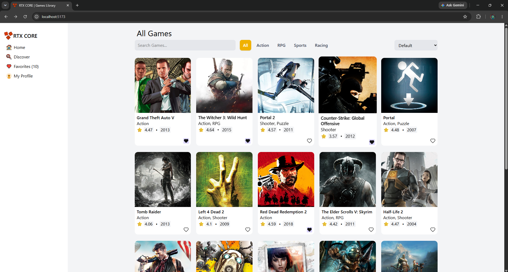
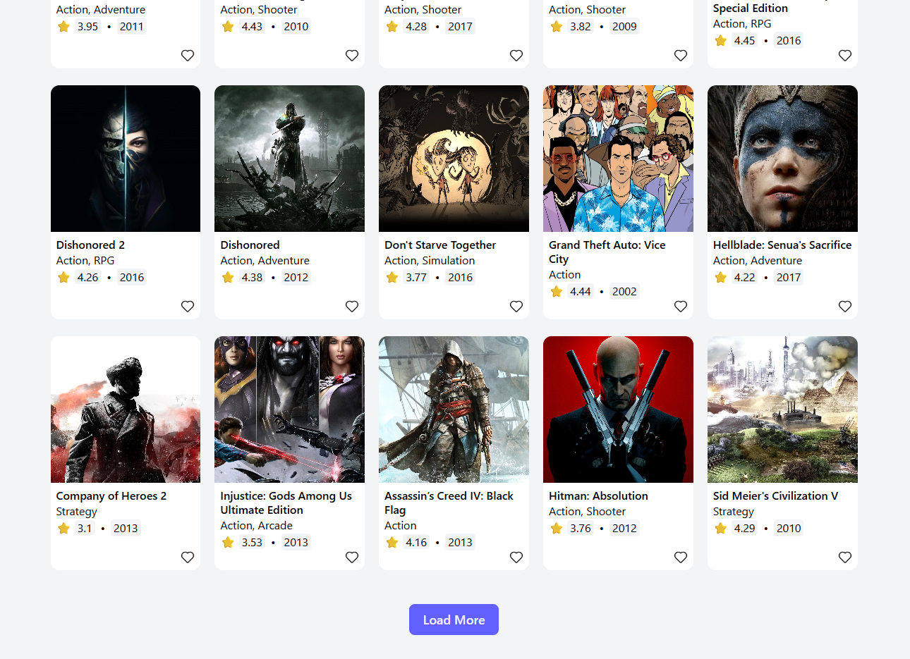
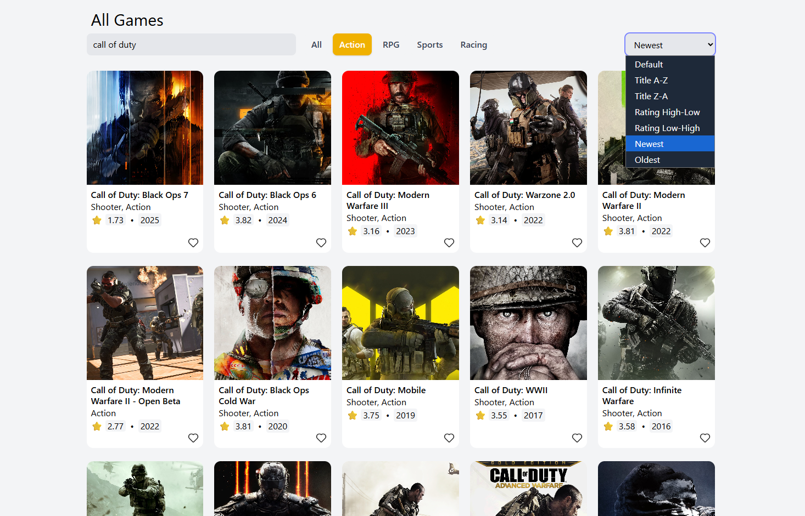
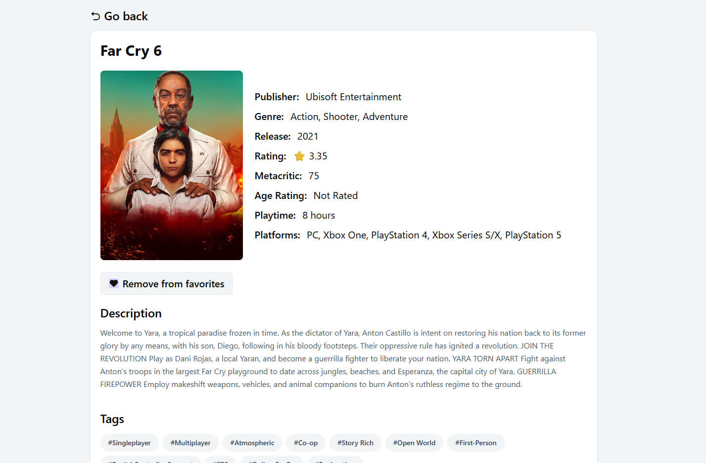
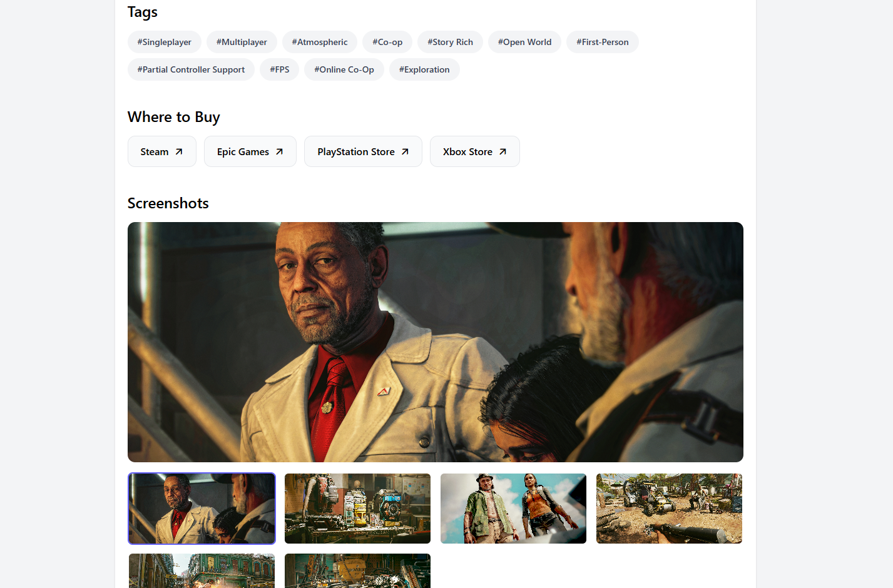
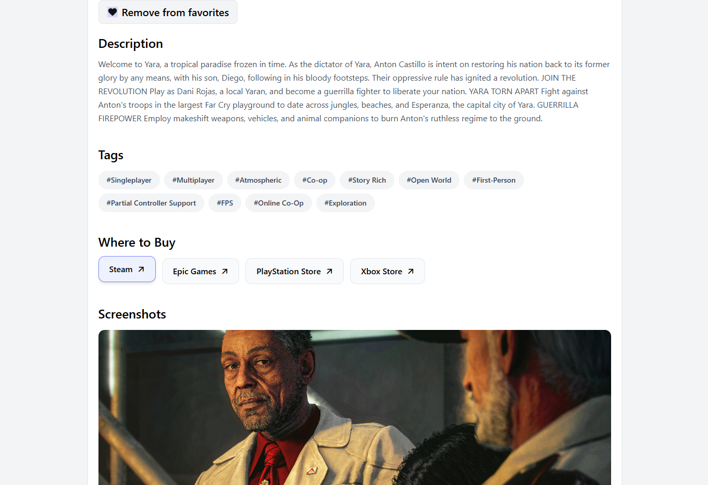
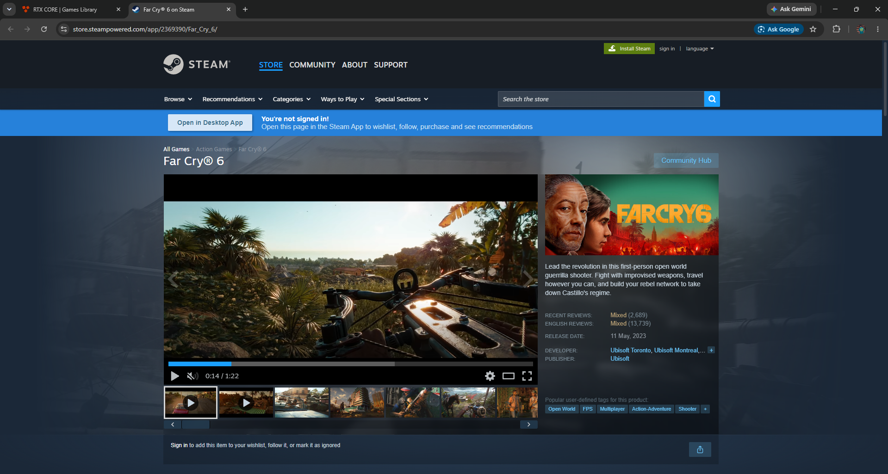
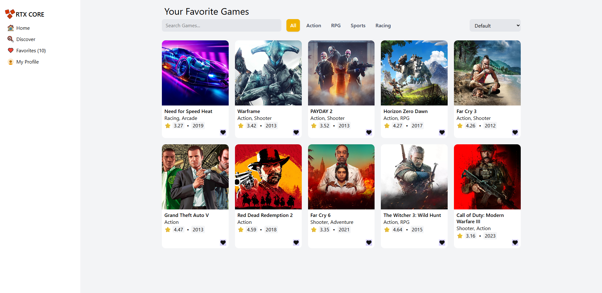

# 🎮 RTX CORE — Games Library

A modern and responsive game discovery platform built with **React**, **Vite**, and **Tailwind CSS**. Explore a wide collection of video games, search for your favorite titles, filter by genre, sort results, and save games to your personal favorites list.

## 🚀 Live Demo

🔗 **Live Website:** [RTX CORE — Games Library](https://rtx-core-games-library.vercel.app/)

🔗 **GitHub Repository:** [RTX-CORE-games-library](https://github.com/Seif-Eldin-Ahmed/RTX-CORE-games-library)

## ✨ Features

- 🎮 **Game Discovery** — Browse a large collection of video games.
- 🔍 **Search Functionality** — Find games by their names.
- 🏷️ **Genre Filtering** — Filter games by categories such as Action, RPG, Sports, and Racing.
- ↕️ **Sorting Options** — Sort games by title, rating, and release date.
- 📄 **Load More Pagination** — Load additional games as you explore.
- ❤️ **Favorites System** — Add or remove games from your personal favorites list.
- 💾 **Persistent Favorites** — Keep your favorites saved using browser local storage.
- 📝 **Game Details** — View additional information about individual games.
- 🖼️ **Screenshots & Stores** — Explore available game screenshots and store information.
- 🔄 **API Integration** — Fetch real game data from the RAWG Video Games Database API.
- ⚡ **Loading & Error States** — Provide feedback while data is loading or when a request fails.
- 📱 **Responsive UI** — A layout designed to adapt to different screen sizes.

## 🛠️ Built With

| Technology                               | Purpose                                 |
| ---------------------------------------- | --------------------------------------- |
| [React](https://react.dev/)              | Building reusable UI components         |
| [Vite](https://vite.dev/)                | Development server and build tooling    |
| [Tailwind CSS](https://tailwindcss.com/) | Utility-first styling                   |
| [React Router](https://reactrouter.com/) | Client-side navigation                  |
| [RAWG API](https://rawg.io/apidocs)      | Video game data and metadata            |
| JavaScript (ES6+)                        | Application logic                       |
| Git & GitHub                             | Version control and source code hosting |
| Vercel                                   | Deployment and hosting                  |

## 📸 Screenshots

















Add screenshots of your application here to showcase the interface.

| Home Page                     | Game Details                     |
| ----------------------------- | -------------------------------- |
| Add your home page screenshot | Add your game details screenshot |

| Favorites Page                | Search & Filters                       |
| ----------------------------- | -------------------------------------- |
| Add your favorites screenshot | Add your search and filters screenshot |

## ⚙️ Getting Started

Follow these steps to run the project locally.

### 1. Clone the repository

```bash
git clone https://github.com/Seif-Eldin-Ahmed/RTX-CORE-games-library.git
```

### 2. Navigate to the project directory

```bash
cd RTX-CORE-games-library
```

### 3. Install dependencies

```bash
npm install
```

### 4. Configure environment variables

Create a `.env` file in the root directory and add your RAWG API key:

```env
VITE_RAWG_API_KEY=your_rawg_api_key
```

Replace `your_rawg_api_key` with your actual API key.

You can obtain an API key through the [RAWG API website](https://rawg.io/apidocs).

**Important:** Never commit your `.env` file or expose API credentials you intend to keep private. Variables prefixed with `VITE_` are included in client-side code and should not be treated as secrets.

### 5. Start the development server

```bash
npm run dev
```

Open the local URL displayed in your terminal to view the application.

### 6. Build for production

```bash
npm run build
```

To preview the production build locally:

```bash
npm run preview
```

## 📁 Project Structure

```text
RTX-CORE-games-library/
├── public/
├── src/
│   ├── api/
│   │   └── gamesApi.js
│   ├── components/
│   │   └── ...
│   ├── hooks/
│   │   └── useGameFilters.js
│   ├── pages/
│   │   ├── Favorites.jsx
│   │   └── ...
│   ├── ui/
│   │   ├── GameCard.jsx
│   │   ├── ToolsBar.jsx
│   │   └── ...
│   ├── utils/
│   │   └── gameUtils.js
│   ├── App.jsx
│   └── main.jsx
├── .env
├── .gitignore
├── package.json
└── README.md
```

_Note: Adjust the folder tree to match the final structure of your project._

## 🔌 API Integration

RTX CORE uses the RAWG Video Games Database API to retrieve game information.

The application uses API requests to support features such as:

- Retrieving lists of games.
- Searching for specific titles.
- Filtering games by genre.
- Fetching detailed information about a game.
- Retrieving screenshots and store information.

API requests are organized in a dedicated API module to keep data-fetching logic separate from UI components.

## 💾 Favorites & State Management

The application manages interactive features using React state and custom hooks.

- **React Hooks** — Manage component state and side effects.
- **Custom Hooks** — Centralize reusable game filtering state.
- **Local Storage** — Preserve favorite games between browser sessions.
- **Reusable Components** — Keep the interface modular and easier to maintain.

## 🚀 Deployment

The application can be deployed using [Vercel](https://vercel.com/).

1. Import the GitHub repository into Vercel.
2. Configure the `VITE_RAWG_API_KEY` environment variable in the project settings.
3. Deploy the application.
4. Push
